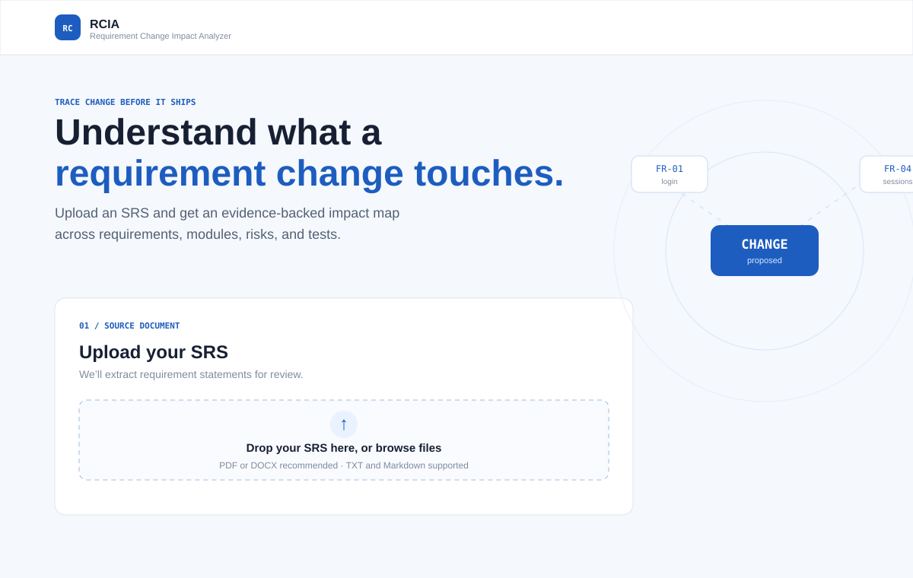
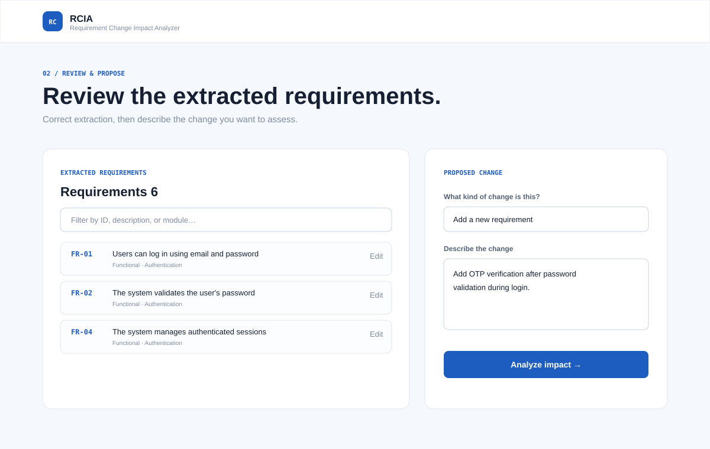
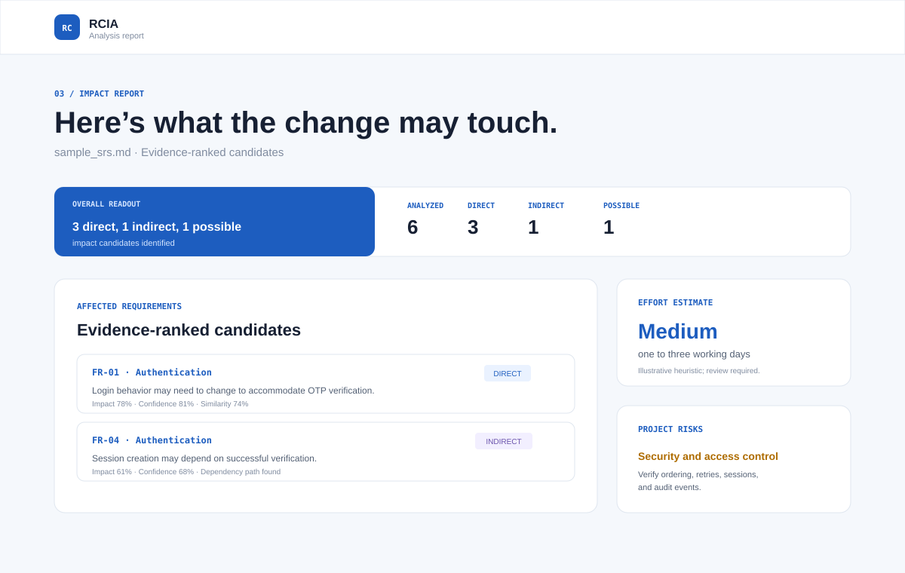

# Requirement Change Impact Analyzer (RCIA)

## Complete Project Report and Technical Documentation

**Live demo:** [https://rcia.onrender.com/](https://rcia.onrender.com/)

**Source repository:** [https://github.com/shridhar07122004/RCIA](https://github.com/shridhar07122004/RCIA)

## 1. Abstract

Requirement Change Impact Analyzer (RCIA) is a local-first, AI-assisted software engineering tool for understanding the consequences of changing a software requirement. A user uploads an SRS document, reviews the extracted requirements, describes a proposed change, and receives an evidence-backed impact report.

The report identifies potentially affected requirements, classifies direct, indirect, and possible impacts, separates severity from confidence, explains the evidence, identifies affected modules and risks, estimates effort, recommends next steps, and generates regression test cases. The core workflow operates without a paid LLM API. Sentence Transformers are used when available; a clearly labelled lexical fallback keeps the application usable when the embedding model cannot be loaded.

## 2. Problem Statement

Software requirements change throughout a project. A change that appears small, such as adding OTP verification to login, may affect password validation, authentication, session management, security requirements, implementation modules, and tests. Manual impact analysis is slow and can miss dependencies.

RCIA helps answer:

1. What could be affected?
2. Why could it be affected?
3. How significant is the potential impact?
4. What should the development team verify next?

RCIA is decision support, not an automatic approval system. All scores are transparent heuristics that require human review.

## 3. Objectives

- Extract meaningful requirements from SRS documents.
- Preserve requirement IDs and create stable `AUTO-###` IDs when IDs are missing.
- Allow users to inspect, edit, and add requirements before analysis.
- Accept add, modify, and remove changes in natural language.
- Compare a proposed change against actual extracted requirements.
- Combine semantic, lexical, dependency, module, and explicit-reference signals.
- Provide explanations grounded in source requirement text.
- Estimate severity, confidence, risks, effort, recommendations, and tests.
- Persist documents and analyses in SQLite.
- Export reports as HTML, JSON, and CSV.

## 4. Scope

### Included

- PDF processing with PyMuPDF.
- DOCX processing with `python-docx`.
- TXT and Markdown support for simple demonstrations.
- Requirement ID and statement extraction.
- Requirement review, filtering, editing, and manual insertion.
- Sentence Transformers semantic similarity with lexical fallback.
- Conservative NetworkX dependency graph generation.
- Rule-based risk and effort analysis.
- SQLite persistence through SQLAlchemy.
- Responsive vanilla HTML/CSS/JavaScript interface.
- Render deployment configuration.

### Limitations of the initial version

- Scanned PDF OCR is not enabled.
- No user accounts or authentication.
- Effort estimates are illustrative rather than historically calibrated.
- SQLite is intended for local or single-instance academic deployment.
- Local files on Render’s free plan are ephemeral.

## 5. Technology Stack

| Layer | Technology | Purpose |
| --- | --- | --- |
| Frontend | HTML5, CSS3, Vanilla JavaScript | Upload, review, analysis, and report UI |
| API | FastAPI | REST API and static-file serving |
| Server | Uvicorn | Local and Render execution |
| Validation | Pydantic | Request validation and response schemas |
| Database | SQLite + SQLAlchemy | Persistent metadata and analysis records |
| Documents | PyMuPDF, python-docx | PDF and DOCX text extraction |
| NLP | Sentence Transformers | Optional semantic embeddings |
| Fallback NLP | Python lexical scoring | Offline comparison mode |
| Graph analysis | NetworkX | Requirement dependency relationships |
| Testing | pytest, FastAPI TestClient | Unit and API verification |

## 6. Architecture

```text
Browser UI
    │ Fetch API
    ▼
FastAPI application
    ├── Upload validation and document parsing
    ├── Requirement extraction and review APIs
    ├── Impact analysis API
    └── HTML / JSON / CSV exports
             │
             ├── Text preprocessing
             ├── Semantic and lexical similarity
             ├── Dependency graph analysis
             ├── Impact scoring
             ├── Explanation service
             ├── Risk and effort estimation
             └── Test-case generation
             │
             ├── SQLite database
             ├── Private uploads directory
             └── Generated report responses
```

### Project structure

```text
requirement-change-impact-analyzer/
├── app/
│   ├── main.py
│   ├── config.py
│   ├── database.py
│   ├── models/
│   ├── services/
│   ├── static/css/
│   ├── static/js/
│   └── templates/
├── docs/screenshots/
├── sample_data/sample_srs.md
├── tests/
├── render.yaml
├── requirements.txt
└── README.md
```

## 7. User Workflow

### Step 1: Upload

The user uploads a PDF, DOCX, TXT, or Markdown document. RCIA validates the extension, MIME type, size, basic file signature, and readable text. Files are stored with generated server-side names outside the public static directory.

### Step 2: Review

The extracted requirements are displayed with IDs, descriptions, categories, and modules. The user can filter the list, edit extracted text, or add a missing requirement manually.

### Step 3: Propose a change

The user selects Add, Modify, or Remove, optionally selects the original requirement, and writes a natural-language change such as:

```text
Add OTP verification after password validation during login.
```

### Step 4: Analyze

The backend compares the proposed change with every reviewed requirement and stores the resulting analysis in SQLite.

### Step 5: Report

The results page presents impact cards, evidence, dependencies, risks, effort, recommendations, and suggested tests. The user can download HTML, JSON, and CSV outputs.

## 8. Requirement Extraction

The extractor uses ID pattern recognition, numbered statements, bullet segmentation, requirement keywords such as `shall`, `must`, `should`, `allow`, and `provide`, and a paragraph fallback for prose SRS documents.

For each requirement, RCIA stores:

| Field | Meaning |
| --- | --- |
| Requirement code | Existing ID or generated `AUTO-###` |
| Description | Cleaned requirement statement |
| Category | Functional, non-functional, or business |
| Module | Inferred feature area such as Authentication or Payments |
| Source reference | Source line or paragraph |

Example:

```text
FR-01: Users can log in using email and password.
FR-02: The system validates the user's password.
NFR-01: The system must protect sensitive user information.
```

If no usable requirements are found, the API returns an understandable error instead of inventing content.

## 9. Impact Analysis Engine

### Semantic similarity

RCIA lazily loads `all-MiniLM-L6-v2` when Sentence Transformers is available. Requirement and change embeddings are normalized and compared using cosine similarity. If model loading fails, the system uses lexical overlap and labels the report:

```text
Lexical fallback (Sentence Transformers unavailable)
```

### Scoring model

```text
Impact Score =
    0.45 × semantic similarity
  + 0.25 × keyword/domain relevance
  + 0.20 × dependency strength
  + 0.10 × explicit reference score
```

All components are normalized from 0 to 1. Default thresholds are configurable:

| Setting | Default |
| --- | ---: |
| Low-impact boundary | 0.25 |
| High-impact boundary | 0.68 |

These are transparent heuristics, not validated probabilities.

### Impact types

- **Direct:** Strong text, selected-target, or domain evidence indicates the requirement may change directly.
- **Indirect:** A supported dependency path connects the change to the requirement.
- **Possible:** Related context exists, but the evidence requires human verification.

Severity and confidence are calculated and displayed separately.

### Dependency graph

Requirements become NetworkX nodes. Edges are created only for defensible relationships:

- Explicit requirement ID references.
- Conservative same-module and shared-term relationships.

Each edge stores source, target, relationship type, evidence, strength, and explicit/inferred status.

## 10. Explainability

Each impact includes:

- Requirement ID and description.
- Impact type and severity.
- Impact, confidence, and similarity scores.
- Shared keywords and domain signals.
- Dependency evidence when available.
- Human-readable explanation.
- Recommended developer action.

The deterministic explanation service uses actual requirement text and analysis evidence. It does not claim unsupported technical behavior.

## 11. Risk and Effort Analysis

The risk rules cover authentication/security, payments/integrations, data compatibility, API compatibility, and broad change surface. Each risk includes a reason and mitigation.

Effort uses direct impacts, indirect impacts, possible impacts, affected modules, and change type:

- **Low:** a few hours.
- **Medium:** approximately one to three working days.
- **High:** more than three working days.

All effort results are explicitly labelled as estimates requiring developer review.

## 12. Test Case Generation

Every generated test includes an ID, objective, preconditions, steps, expected result, related requirement, and category.

For OTP or verification changes, RCIA generates cases for valid verification, invalid codes, expired/reused codes, and excessive attempts. Payment changes receive success and provider-failure cases. Other changes receive valid-workflow and invalid-input cases.

## 13. Database Design

SQLite tables include:

- `documents`: filename, hash, storage path, timestamp, extraction status.
- `requirements`: document link, code, description, category, module, source reference.
- `analyses`: document, change type, proposed change, summary, risk, serialized result.
- `impact_results`: affected requirement, type, score, severity, confidence, explanation, evidence, action.
- `test_cases`: analysis link, objective, preconditions, steps, expected result, category.

Documents are stored privately and associated database records can be deleted through the API.

## 14. REST API

| Method | Endpoint | Purpose |
| --- | --- | --- |
| GET | `/api/health` | Service status |
| POST | `/api/documents/upload` | Validate, parse, and extract an SRS |
| GET | `/api/documents/{document_id}/requirements` | Retrieve requirements |
| PUT | `/api/requirements/{requirement_id}` | Edit a requirement |
| POST | `/api/documents/{document_id}/requirements` | Add a requirement |
| POST | `/api/analysis` | Run and save an analysis |
| GET | `/api/analysis/{analysis_id}` | Retrieve a saved analysis |
| GET | `/api/analysis/{analysis_id}/export?format=html\|json` | Export report |
| GET | `/api/analysis/{analysis_id}/test-cases.csv` | Export tests |
| DELETE | `/api/documents/{document_id}` | Delete document and related records |

## 15. Screenshots

The following UI reference screenshots correspond to the implemented workflow. They are stored in `docs/screenshots/` and can be viewed directly from GitHub.

### Upload screen



### Requirement review screen



### Impact report screen



The interactive version is available at [https://rcia.onrender.com/](https://rcia.onrender.com/).

## 16. Local Installation

```powershell
cd "C:\Users\Shridhar kalasgonda\Downloads\internship\requirement-change-impact-analyzer"
python -m venv .venv
.venv\Scripts\Activate.ps1
pip install -r requirements.txt
python -m uvicorn app.main:app --host 127.0.0.1 --port 8123
```

Open `http://127.0.0.1:8123` and upload `sample_data/sample_srs.md`.

## 17. Render Deployment

The repository includes `render.yaml`:

```text
Build Command: pip install -r requirements.txt
Start Command: uvicorn app.main:app --host 0.0.0.0 --port $PORT
Health Check Path: /api/health
Plan: free
```

Live deployment: [https://rcia.onrender.com/](https://rcia.onrender.com/).

Render’s free service is suitable for a public academic demonstration, but it may sleep after inactivity and its local filesystem is ephemeral. SQLite data and uploads should not be treated as permanent on the free plan. A persistent disk or external database is required for durable production storage.

## 18. Testing

Run:

```powershell
pytest -q
```

Current result:

```text
8 passed
```

Coverage includes extraction, stable IDs, explicit references, module inference, fallback impact analysis, no-forced-impact behavior, upload validation, health endpoint, upload API, and analysis persistence.

The browser workflow has also been verified end-to-end: upload, extraction, review, proposal, analysis, report rendering, fallback notice, risks, effort, tests, HTML export, JSON export, and CSV export.

## 19. Security and Reliability

Implemented safeguards include extension/MIME/size/signature checks, safe generated filenames, private upload storage, no execution of uploaded content, Pydantic validation, SQLAlchemy parameterized access, limited error exposure, configurable CORS, and explicit deletion.

For production, add authentication, rate limiting, backups, centralized logging, stronger file inspection, consent and redaction for external LLM use, and a managed database.

## 20. Future Enhancements

- OCR for scanned PDFs.
- Richer spaCy entity extraction.
- Interactive dependency graph visualization.
- Requirement version history and traceability matrix.
- Product-owner approval workflow.
- Historical data for calibrated effort estimates.
- Authentication and role-based access.
- Managed database and object storage.
- Background processing for very large SRS files.
- Continuous integration and deployment gates.

## 21. Conclusion

RCIA demonstrates transparent AI-assisted requirement analysis. It combines document extraction, similarity, dependency analysis, explainability, risk rules, effort heuristics, and regression-test generation in a simple application suitable for an academic project demonstration. Its central design principle is that a similarity match is evidence for review, not proof that a requirement must change.
